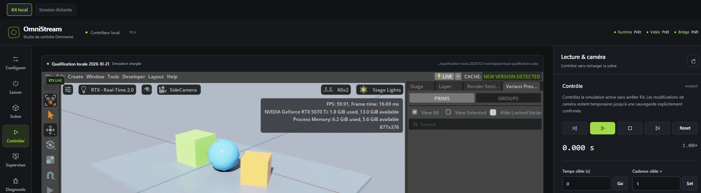

# Qualification locale — 21 octobre 2026

## Verdict

**Fonctionnement local validé sur la cible décrite ci-dessous, avec une réserve
bloquante sur l'intégration au panneau Codex. La version reste `1.0.0-rc4`.**

La chaîne réelle panneau → MCP → Kit → WebRTC fonctionne dans Chrome via le
harness local : image RTX décodée, souris et clavier natifs, commandes de
timeline, changement de caméra et arrêt sûr. Les contrôles automatiques complets
passent sans `SkipKitTests` ni `SkipRuntimeSmoke`.

Dans Codex, l'appel d'ouverture renvoie son message de succès mais l'inventaire
MCP Apps ne contient aucun onglet. L'opérateur signale un bug du plugin dans
Codex. Cette exécution ne permet pas d'en établir la cause ni de certifier le
panneau intégré. Le résultat Chrome ne ferme pas ce critère.

## Cible et identité

| Élément | Cible observée |
|---|---|
| Source | Candidate RC4, basée sur `02d9fac248d85b76fdbd93bd18bac2bf33be7732`, avec les changements RC4 déjà présents et les corrections de cette qualification |
| Système | Windows x64 |
| GPU | NVIDIA GeForce RTX 5070 Ti, 16 303 MiB annoncés par `nvidia-smi` |
| Pilote | 616.56 |
| Node / npm | 24.14.0 / 11.9.0 |
| Runtime | Projet Kit existant, canal `Existing`, lancement sans fenêtre native |
| SDK navigateur | `@nvidia/ov-web-rtc` 6.6.0, obtenu localement |
| Build web | Vite 6.4.5 |
| Transport | Signaling MCP local ; média WebRTC NVIDIA réel |
| Scène visuelle | Copie isolée de `tests/fixtures/local-qualification.usda`, deux caméras, éclairage et formes colorées |

Le [reçu expurgé](evidence/local-2026-10-21/receipt.json) contient les identités
des fichiers exécutables source/bundle, les mesures et hashes des logs retenus.
Le manifeste de livraison identifie les octets source publiés. Les captures
historiques restent attachées à leur candidate ; elles ne sont pas réattribuées
à ce run.

## Résultats automatiques

| Vérification | Résultat et portée |
|---|---|
| `installer/test.cmd` depuis la source candidate | **PASS**, sans option d'exclusion : syntaxe/TypeScript, MCP, panneau source/construit, reconstruction finale, diagnostic strict, projet NVIDIA et smoke runtime |
| `npm test` | **102 tests Node réussis**, un skip Windows sur les privilèges de création de symlink ; protocole MCP et contrats du panneau passent aussi |
| OpenUSD, `OMNISTREAM_REQUIRE_USD=1` | **34 tests réussis, zéro skip**, venv OpenUSD existant |
| Projet NVIDIA `repo.bat test` | **PASS** ; les quatre tests réels du bridge OmniStream et son démarrage passent. Les applications `.kit` sans test d'extension ne sont pas comptées comme tests fonctionnels supplémentaires |
| `npm run test:runtime` | **PASS** : configuration/preflight/lancement, supervision, contrôles, caméra, preview/apply/undo, watcher et watchdog local ; handle de fenêtre native nul et arrêt vérifié |
| `npm run test:physics` | **PASS** : chute effective d'un corps, déplacement observé dans USD, source préservée et arrêt sûr |
| `npm --prefix web audit --json` | **PASS**, zéro vulnérabilité signalée au contrôle du 21 octobre |
| Build et contrats après correction du rattachement | **PASS** : syntaxe/TypeScript, suite source, build réel, contrats de la ressource MCP et du bundle |

Le rapport automatique conserve `visualWebRtcVerified`, `codexHostVerified` et
`productionReady` à `false`. Un script ne se certifie pas lui-même visuellement.
Le reçu navigateur apporte une preuve distincte pour Chrome uniquement.

## Parcours visuel réellement observé

1. Scanner le workspace isolé trouve le fichier attendu. Valider/préflighter la
   configuration n'ouvre pas Kit. Le résumé montre la caméra initiale et le
   stage avant lancement.
2. Lancer charge la scène et connecte le bridge. Le handle de fenêtre du
   processus géré vaut zéro. Les objets visibles correspondent à la fixture.
3. Le navigateur reçoit une vidéo de **1280 × 720**, `readyState = 4`.
   Deux mesures donnent **2 915 puis 5 640 frames** à **24,131 puis 47,141 s** de
   temps média. Le compteur de frames perdues vaut respectivement 39 et 40.
   Ces mesures attestent un décodage continu ; elles ne constituent pas un
   benchmark de latence ou de performances.
4. Un clic natif dans le flux sélectionne `/World/Ground` dans Kit, avec contour
   et gizmo visibles. La touche native `F` change le cadrage de l'objet
   sélectionné. Aucun résultat de souris/clavier Codex n'est déduit de ce test.
5. Lecture puis pause font évoluer la timeline de 0 à 10 s. Le seek à 1,25 s,
   puis un pas à 24 images/s, donnent **1,292 s**. Choisir
   `/World/SideCamera` change effectivement la vue sans relancer Kit.
6. Le dialogue d'arrêt place d'abord le focus sur Annuler ; Tab passe sur la
   confirmation, Shift+Tab revient sur Annuler, Échap ferme le dialogue et
   rend le focus au bouton d'arrêt. Une seconde ouverture suivie d'une
   confirmation native termine Kit.
7. La supervision finale indique runtime au repos, vidéo/bridge hors ligne,
   aucune scène et aucun processus. Le PID exact n'existe plus et aucun listener
   TCP de signaling ne reste. Les fichiers USD source et copie ont le même
   SHA-256 : `2c5e0dbe1460b873b8eb515361afe256840c12dc3708dcadf9462c61ff96e756`.

La capture publiée est cadrée lors de la capture pour montrer le produit et le
viewport, sans bureau, profil navigateur ou configuration personnelle. Les
captures complètes et observations brutes sont conservées dans les preuves
locales ignorées par Git.

## Défauts trouvés et corrections

- Le diagnostic strict utilisait une ancienne liste de clés et refusait
  `signalingTls`, `panelSignalingTransport` et `remoteSessions`. Il lit désormais
  les clés du schéma et vérifie les structures de transport/TLS/profils sans
  recopier leurs valeurs privées dans le résultat.
- Réparer une installation aurait perdu les options récentes. La sauvegarde
  conserve les trois champs optionnels existants, y compris la forme tableau
  d'un profil unique. Un test PowerShell exécute la vraie fonction de sauvegarde
  dans un dossier temporaire, sans modifier la configuration opérateur.
- L'audit initial signale une vulnérabilité élevée dans Vite 6.4.3. La candidate
  épingle 6.4.5 et l'audit complet est relancé avec zéro alerte.
- Demander Rattacher alors que des frames arrivent déjà créait une deuxième
  instance SDK ; le nouveau peer échouait alors que l'ancien média continuait.
  Le rattachement du même runtime déjà actif devient idempotent. La capture et
  le journal de l'échec initial restent dans les preuves locales.
- L'auditeur contenait lui-même des fragments d'identité opérateur. Ils sont
  retirés et remplacés par des marqueurs privés fournis seulement via
  `OMNISTREAM_AUDIT_PRIVATE_MARKERS` lors du contrôle local. Un test vérifie le
  refus d'un marqueur sans en recopier la valeur dans le message d'erreur.

Un second cycle navigateur charge le bundle corrigé. Demander Rattacher sur
le flux actif affiche « aucune reconnexion nécessaire » et les compteurs vidéo
continuent leur progression. Le runtime et la scène restent les mêmes. La
capture publique provient de ce second cycle ; le reçu identifie son bundle.

Le premier collecteur PowerShell interprétait les sorties stderr ordinaires
comme des erreurs ; ses reçus ne servent pas de verdict produit. Le collecteur
Node utilise les vrais codes de sortie. Les échecs initiaux sont conservés,
séparément des résultats après correction.

## Limites et critères encore ouverts

- **Panneau Codex non ouvert** : aucune qualification de sa vidéo, de ses
  interactions, de ses dialogues ou de trois cycles complets dans cet hôte.
  Cause non établie ; le succès du message d'ouverture n'est pas une preuve UI.
- **Installation** : réutilisation d'un projet Existing déjà construit et de
  dépendances locales. Installation Production vierge, réparation complète,
  reprise après interruption et désinstallation non exécutées. Le test de
  conservation de configuration couvre la fonction, pas ce cycle complet.
- **Reconnexion après perte réseau réelle** : distincte du clic redondant sur
  un flux vivant ; aucune coupure réseau ou panne GPU n'est injectée ici.
- **Périmètre** : aucun runtime distant/cloud, port public ou service multiuser
  n'est qualifié. Les tests de profils distants valident seulement leurs
  contrats source. Aucun asset privé FireViewer n'est utilisé pour ces captures.
- **Performance** : essai sur une petite scène, sans soak test ni charge de
  production. Le runtime Existing diffuse aussi ses panneaux Kit. Un warning
  de budget de texture apparaît durant l'essai ; aucune absence de warning ni
  capacité mémoire pour de grandes scènes n'est certifiée. Vite signale un
  bundle supérieur à 500 kB ; le SDK n'est pas redistribué dans les sources.
- **Simulation** : télémétrie USD jusqu'à 4 Hz, UI à 1 Hz, pas de temps réel dur.
  Un état Fabric interne n'est pas automatiquement visible dans USD ; cadence
  cible et `kitUpdateMs` ne sont ni dilatation physique ni mesure de FPS GPU.

## Reproduction et publication

Le [guide local](LOCAL-SETUP.md) décrit setup, configuration, utilisation,
commandes, capture de preuve et récupération. La fixture reste un fichier de
test ; elle n'est pas installée dans un workspace utilisateur.

Les données brutes restent sous le répertoire `release/` ignoré. Seuls le rapport,
une capture inspectée et un reçu composé par liste de champs autorisés sont
publiables. Le contrôle de l'index Git, l'inspection de la capture, la recherche
de chemins/identifiants personnels et de secrets, ainsi que le contrôle de
l'identité no-reply du nouveau commit précèdent l'envoi du commit. L'historique
existant n'est pas réécrit.
