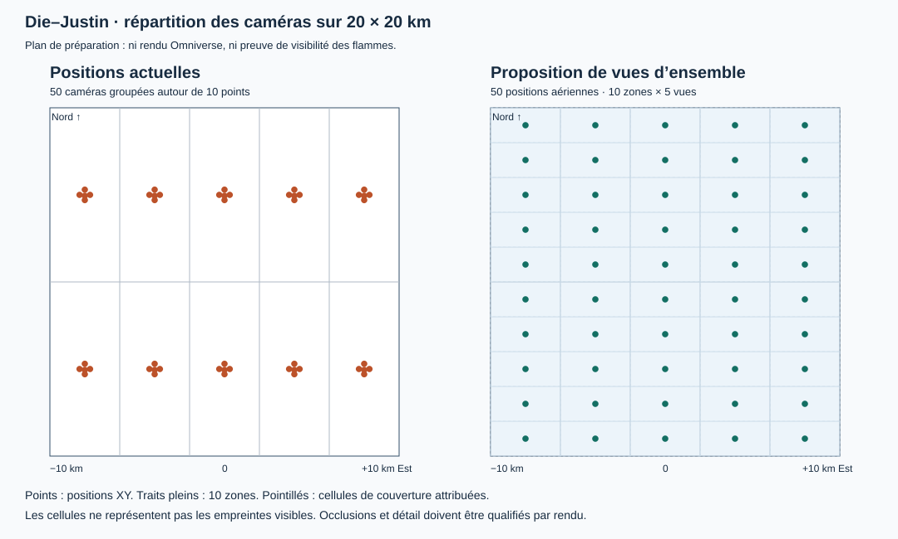
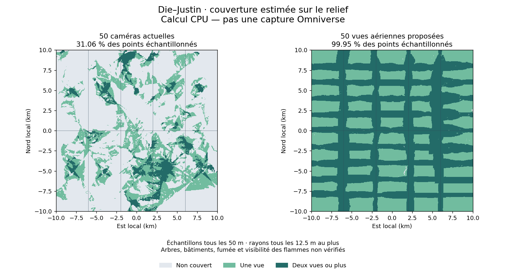

# Die–Justin : calcul par zones et couverture des caméras

Statut au 27 octobre 2026 : **préparation CPU mesurée, chargement spatial de production et rendu géographique non qualifiés**. La scène source complète de 20 × 20 km est conservée. Aucun nouveau lancement de simulation complète n'a été effectué pour cette étude.

## Méthode retenue

Le chargement visuel peut suivre les caméras, mais le moteur d'incendie doit conserver une histoire commune. Une source de fumée hors champ, un front entrant ou un objet qui projette une ombre peuvent modifier l'image. Le seul cône de vision n'est donc pas un domaine physique fermé.

1. Le moteur avance une chronologie commune, avec les données de combustible, météo et fronts disponibles. Les données physiques légères sont distinctes des meshes et textures destinés au rendu. Cette séparation ne prouve pas encore que le moteur disponible sait traiter 400 km² dans le budget.
2. À une échéance de capture exprimée en temps simulé, tous les producteurs sont figés : propagation, Flow, animation et autres systèmes externes concernés, pas uniquement la timeline USD.
3. Pour chaque vue demandée, le gestionnaire prépare les assets visibles et leurs dépendances hors champ, puis produit l'image avec **un seul Render Product actif**. Les cinq vues d'un groupe partagent le même instant et la même empreinte d'état, même si elles sont calculées successivement.
4. La simulation reprend après les captures et les vérifications. Les contrôles OmniStream portent sur cette même scène et ce même moteur. La vidéo du panneau ne constitue pas le fichier source des captures scientifiques.
5. Les fichiers validés peuvent être transférés au Drive autorisé ; la suppression du spool local reste conditionnée à la vérification du contenu distant. Aucun transfert n'est réalisé par les outils de couverture.

Rejouer une séquence par caméra devient possible seulement avec des checkpoints complets ou un replay démontré équivalent : même état des cellules, mêmes champs de fumée/température/combustible/vitesse, mêmes seeds, météo, horloge et version de scène. Une réinitialisation indépendante par caméra peut changer le résultat et multiplier le coût de simulation. **Le restore complet de Flow n'est pas actuellement qualifié.** Le journal déterministe du moteur de grille ne suffit pas à restaurer ses champs volumétriques.

## Mesure de la couverture actuelle

Les 1 600 meshes de terrain LOD8 ont été lus individuellement, comparés à leurs SHA-256 annoncés et raccordés avec contrôle des coutures. Cette lecture ne charge ni la végétation ni Kit. La maille du relief livré est de 7,9365 m ; l'étude n'utilise pas la résolution source MNT de 0,5 m comme si elle était conservée dans ce mesh.

La mesure finale porte sur 160 000 points espacés de 50 m, placés à 2 m au-dessus du relief. Les rayons vers les caméras sont échantillonnés au maximum tous les 12,5 m horizontalement. Une crête plus fine, un bâtiment, un arbre ou la fumée peuvent modifier la visibilité réelle. Les pourcentages ci-dessous sont des **estimations de couverture des points de terrain**, pas une garantie sur chaque mètre carré ni une annotation de flammes visibles.

| Indicateur | Caméras actuelles | Proposition de vues d'ensemble |
| --- | ---: | ---: |
| Caméras / groupes | 50 / 10 | 50 / 10 |
| Points visibles après test du relief | 49 698 / 160 000 | 159 928 / 160 000 |
| Couverture échantillonnée | 31,061 % | 99,955 % |
| Points vus par au moins deux caméras | 7,417 % | 49,997 % |
| Échelle frontale optimiste médiane, Full HD | 3,41 m/pixel | 2,53 m/pixel |
| Échelle frontale optimiste au percentile 95 | 8,48 m/pixel | 2,91 m/pixel |
| Tuiles statiques avec marge de contexte, médiane / maximum | 70 / 964 | 103 / 128 |

L'échelle frontale est `profondeur / focale_en_pixels`. Elle ne tient pas compte du raccourcissement sur le relief et **n'est ni un GSD terrain validé ni la taille projetée d'une flamme verticale**. Les nombres de tuiles utilisent une hauteur maximale d'asset supposée de 100 m et une marge horizontale de contexte de 500 m. Ce sont des paramètres exploratoires, pas des bornes physiques vérifiées ni une estimation de VRAM.

La proposition répartit cinq vues aériennes virtuelles sur chacune des dix zones existantes, à raison d'une cellule attribuée de 4 × 2 km par vue. Les identifiants de zones et de caméras sont conservés. Les 50 poses et optiques ont été écrites puis relues dans une couche USD séparée ; **la configuration active n'a pas été remplacée**. Ces positions ne sont pas des emplacements de surveillance terrestres relevés sur le terrain.





La couverture large et le détail des flammes nécessitent deux échelles. Les vues d'ensemble conviennent à la répartition du panache et des fronts. Les détails du feu nécessitent des vues plus proches des régions actives, définies et identifiées séparément, puis qualifiées visuellement. Ajouter ces vues ne doit pas supprimer les captures négatives ni les transitions. La banque de vues rapprochées et sa politique de sélection restent à construire ; les 50 vues aériennes ne constituent pas à elles seules un jeu de données complet sur les flammes.

Le calcul final, incluant la comparaison et l'écriture des caméras USD, a duré 151,70 s sous contrôle hôte. Pic de mémoire engagée du Job : **237 604 864 octets** ; pic résident du processus : **160 129 024 octets** ; plafond dur appliqué : **599 998 464 octets**. Aucun GPU n'a été utilisé par ce calcul. Un premier départ a été refusé avant démarrage faute de RAM disponible, puis l'essai a pu être effectué lorsque la réserve hôte de 4 Go était de nouveau assurée.

Le [premier calcul à 100 m](evidence/spatial-coverage-20261027/coverage-report-100m.json), avec des rayons espacés de 25 m, donnait 31,2025 % et 99,9625 %. L'écart avec le calcul à 50 m est respectivement de −0,14125 et −0,0075 point de pourcentage. Ce contrôle de sensibilité ne valide pas les occlusions des assets ni la convergence jusqu'à la résolution du MNT source.

## Chargement spatial et dépendances

`coverage.py` calcule les bases des caméras, les tests de frustum, une visibilité terrain échantillonnée et la proposition aérienne. `residency.py` produit une liste conservative de tuiles statiques et distingue cette liste du domaine de simulation.

Les payloads OpenUSD peuvent être chargés et déchargés par ensembles. Cela agit sur la composition de la scène ; ce mécanisme ne restaure pas automatiquement la physique ou les champs Flow. Voir la documentation officielle [`UsdStage.LoadAndUnload`](https://openusd.org/release/api/class_usd_stage.html).

Le futur fournisseur de résidence doit établir, pour l'empreinte d'état demandée :

- la présence des assets visibles, avec des limites géométriques vérifiées ;
- les dépendances d'éclairage hors champ ;
- les sources et champs de fumée susceptibles d'entrer dans la vue ;
- les collisions et autres dépendances physiques ;
- le gel de tous les producteurs pendant le chargement et les captures ;
- l'absence de déchargement d'un producteur dont l'état n'est pas sauvegardé et restaurable.

Le pilote Replicator rejette désormais un reçu qui ne contient que `visible_assets_complete=true`. Il exige aussi la déclaration de ces garanties et une empreinte d'état commune. Ce contrôle de contrat ne vérifie pas à lui seul la justesse physique du fournisseur : celui-ci et ses preuves natives doivent être qualifiés séparément. Un plan CPU retourne volontairement `production_culling_allowed=false` et ne peut pas servir de certificat de résidence.

Une marge de transport peut être estimée à partir de bornes explicites : `(vitesse_vent_max + vitesse_propagation_max) × horizon_simulé + incertitude`. Si ces bornes ou le traitement aux limites ne sont pas fournis par le moteur, le chargement physique ne peut pas être réduit sur cette seule formule. L'horizon doit couvrir la durée de vie pertinente de la fumée, pas simplement le temps entre deux images. Aucune valeur de cette formule n'est déduite artificiellement des états du moteur.

## Reproduction

Outils : Python 3.11+ avec NumPy et les bindings OpenUSD compatibles avec les fichiers de scène ; le Python fourni avec le SDK est utilisable sans démarrer Kit si ses bibliothèques USD sont configurées. Sous Windows, lancer l'analyse dans le Job Object de `pipelines/local_execution/bounded_process.py`, avec un budget CPU de 600 Mo et une réserve hôte de 4 Go. Les paramètres ci-dessous sont des chemins de projet à renseigner, sans identifiants privés.

```text
python pipelines/event_capture/tools/analyze_scene_coverage.py
  --scene <dossier-scene-complete>
  --config <configuration-50-cameras.json>
  --output <nouveau-dossier-analyse>
  --sample-spacing-m 50
  --ray-spacing-m 12.5
  --overview-columns 5
  --overview-rows 10
```

Passer `--terrain-cache <precedent-dossier-analyse>` réutilise le tableau de hauteurs après vérification de son empreinte. Le tableau ne remplace pas la validation du package complet. La première analyse crée environ 25,4 Mo de cache de relief et des rapports légers ; les suivantes ne dupliquent pas ce cache. Les sources ne sont jamais réécrites. Un nouveau dossier de sortie est obligatoire.

Pour les tests CPU, ajouter `pipelines/event_capture/src` au `PYTHONPATH` puis exécuter `python -m unittest discover -s pipelines/event_capture/tests`. Ils couvrent notamment une crête occultante, les bords de frustum, la conservation des groupes, une fumée provenant du hors-champ et le refus d'états figés incohérents. **Ces tests ne qualifient pas le rendu natif.**

Résultats : 53 tests de la suite réussis, trois tests OpenUSD ignorés dans l'environnement Python général ; après ajout des derniers contrôles d'entrée, les 13 tests ciblés de couverture/résidence ont réussi. Les essais ont été exécutés sous le plafond de 600 Mo. Le bac à sable bloquait la socket locale interne d'asyncio avant l'exécution des tests asynchrones ; les essais diagnostiques ont expiré sous garde, puis les tests ont réussi hors de ce bac à sable avec les mêmes limites de ressources. Aucun Kit n'a été lancé pour les tests.

## Preuves conservées et étapes restant à valider

- [Rapport numérique et limites](evidence/spatial-coverage-20261027/coverage-report.json).
- [50 positions, optiques et groupes proposés](evidence/spatial-coverage-20261027/overview-cameras.json).
- [Couche USD indépendante des 50 caméras](evidence/spatial-coverage-20261027/overview-cameras.usda).
- [Mesure des ressources CPU](evidence/spatial-coverage-20261027/cpu-resource-receipt.json).

Avant production : construire et éprouver le fournisseur de résidence avec ses dépendances réelles ; qualifier le raccordement du moteur et de Flow sur Die avec les données météo ; vérifier les vues détaillées, les changements de zones et les reprises ; produire de vraies captures natives synchronisées et une preuve distincte du flux/contrôle OmniStream. Les reçus actuels du laboratoire Flow ne valident pas une physique d'incendie calibrée sur le territoire. Le moteur de grille disponible reste un modèle cosmétique déterministe, sans calibration scientifique acquise.

Les plafonds autorisés restent **15 Go de VRAM et 12 Go de RAM**, avec seuils d'arrêt en amont et une réserve système. Le nombre de tuiles seul ne garantit pas leur respect. Tant que la RAM disponible ne permet pas l'admission protégée, aucun essai Kit lourd ne doit être relancé. Les gains de mémoire, la stabilité longue et la vitesse de la simulation complète restent à mesurer sur le chemin natif final.
